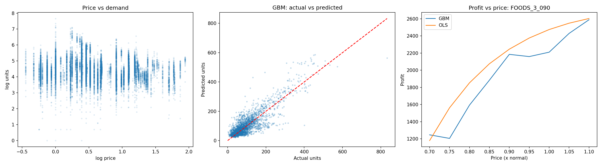
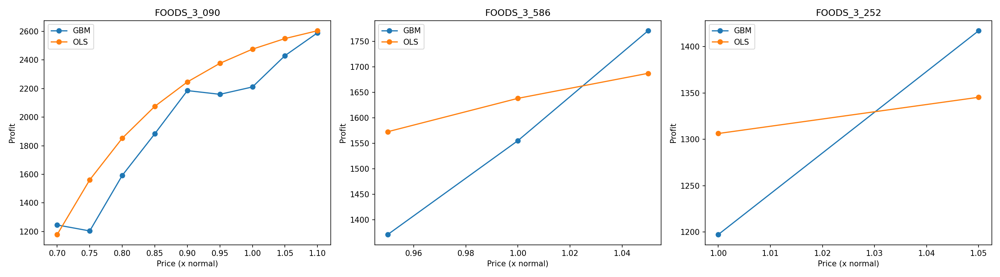

# Price Elasticity & Pricing Simulation (Revenue Growth Management)

Estimating how price changes affect retail demand, and simulating how pricing decisions
affect profit, using Walmart M5 sales data.

## Problem
How does a change in price affect unit demand, and which price levels protect profit?
Revenue growth management (RGM) teams make these decisions every day across pricing,
promotions and markdowns. This project is a small-scale version of that workflow:
measure price sensitivity from historical data, build a demand model, then simulate
pricing scenarios.

## Data
Walmart M5 Forecasting dataset (Kaggle): daily unit sales per item and store, weekly
sell prices, and a calendar with events and SNAP (food assistance) days.

- **Scope:** store CA_1, FOODS category, top 100 items by total units sold
- **Initial table:** 23,960 item-week rows across 100 items
- **Filtering:** kept the 63 items whose price differed from their normal (median) price
  by more than 2% in over 10% of weeks. Items with no price variation cannot inform
  elasticity.

Data source: https://www.kaggle.com/c/m5-forecasting-accuracy/data
(not included in this repo because of file size)

## Approach
1. **Data preparation:** converted daily sales to item-week level, merged weekly sell
   price and calendar features (month, week of year, event flag, SNAP days), and
   computed relative price (price / item's median price).
2. **Price elasticity:** log-log OLS regression of weekly units on price, with item and
   month fixed effects plus SNAP and event controls. The coefficient on log price is
   the elasticity.
3. **Demand models:** compared the regression with a gradient boosting model
   (`HistGradientBoostingRegressor`) using a time-based split (final 52 weeks held out
   as the test set).
4. **Price simulation:** for the three top-selling items, swept price across each
   item's observed range, predicted units with both models, and computed profit under
   an assumed unit cost.

## Results

| Model | R² (test) | MAPE (test) |
|---|---|---|
| OLS (log-log) | 0.66 | 39.5% |
| Gradient boosting | 0.70 | 40.8% |

- **Estimated price elasticity: -1.81** (p < 0.001). A 10% price change is associated
  with roughly an 18% change in units in the opposite direction, so demand in this
  category is price-elastic.
- Gradient boosting improved R² slightly but not MAPE, so the two models perform
  similarly. The regression is used for the elasticity estimate because it is directly
  interpretable.
- Both models tend to underpredict the highest-volume weeks.

### Pricing simulation
For the three top-selling items, both models showed profit increasing as price moved
from discounted levels toward normal and slightly higher prices, under the assumed 60%
unit cost.

- **FOODS_3_090** (widest observed price range, 0.70x to 1.10x of normal price): deep
  discounts raised units sharply (about 8,600 at 0.70x vs. about 3,800 at normal
  price) but reduced profit.
- **FOODS_3_586** and **FOODS_3_252** had narrow observed price ranges (3 and 2 price
  points respectively), so those results are indicative only.

The simulation shows direction, not an optimal price. Profit was still rising at the
upper edge of the observed range, and no price beyond that range can be supported by
this data.

## Assumptions and limitations
- **Unit cost is not in the data.** I assumed cost = 60% of each item's median price.
  Profit conclusions depend on this assumption.
- **Elasticity is associational, not causal.** Price cuts often coincide with
  promotions, displays or flyers, so part of the estimated effect may come from those.
- **One average elasticity** is estimated across items; individual items will differ.
- **Narrow price ranges** for some items limit what the simulation can say. Tree-based
  models cannot extrapolate, so simulations are restricted to observed ranges.
- **The simulation scenario** uses each item's most recent 8 weeks as the baseline for
  other features (month, events, SNAP days).
- No competitor prices, stock levels or promotion flags are available.
- A controlled price test would be needed before acting on any recommendation.

## How to run
1. Download `sales_train_evaluation.csv`, `sell_prices.csv` and `calendar.csv` from the
   Kaggle link above.
2. Open `notebook.ipynb` in Jupyter or Google Colab and update the data path.
3. Run all cells in order.

## Tech stack
Python, pandas, NumPy, statsmodels, scikit-learn, matplotlib

## Author
Chitraksh Sonkar  
GitHub: https://github.com/Chitraksh592  
LinkedIn: https://www.linkedin.com/in/chitraksh-sonkar-5574bb319
